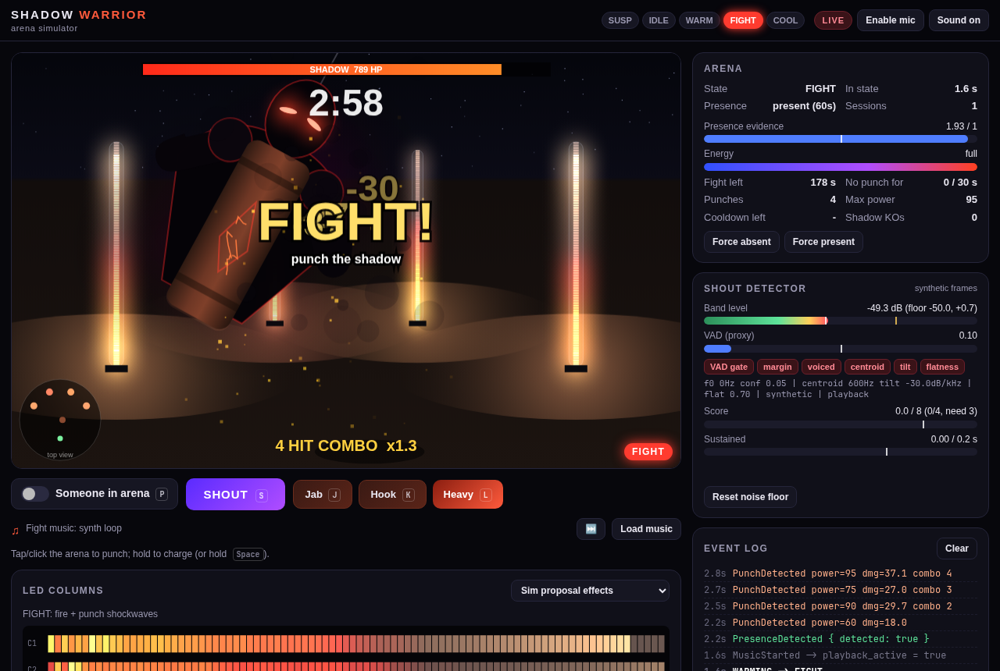
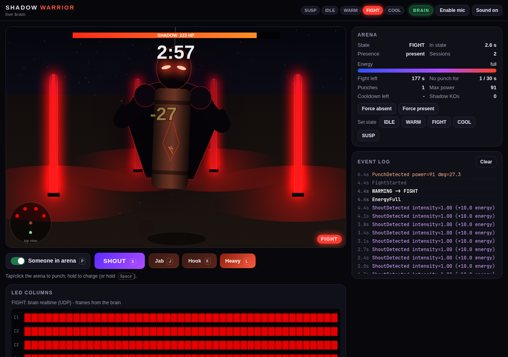

# Run the game at home

How to run Shadow Warrior on your own laptop with your own LED strip and punching bag, step
by step. It covers the browser simulator driving the real hardware (sim mode) and the real
`brain-rs` driving it (brain mode). Details behind each step are in
[`simulator/web/README.md`](../simulator/web/README.md) ("Live hardware").

## What you need

| Thing | Notes |
| --- | --- |
| Laptop on the same Wi-Fi as the strip | Linux (BlueZ) or macOS, with Bluetooth on. |
| WLED strip | Running WLED, on your LAN. You need its IP (step 2). |
| Bag sensor (XIAO nRF52840 Sense, `punching_bag` firmware) | Powered over USB (it has no battery). It advertises as `ShadowWarriorPunchingBag`. |
| `git`, [uv](https://docs.astral.sh/uv/) | `curl -LsSf https://astral.sh/uv/install.sh \| sh`. uv fetches the bridge's Python packages itself. |
| Rust (`cargo`) | Brain mode only, for the first build: <https://rustup.rs>. |
| `yt-dlp` + `ffmpeg` | Optional, for the fight music (step 3). |

## 1. Get the code

```sh
git clone https://github.com/yardenhochman/shadow-warrior.git
cd shadow-warrior
```

All commands below run from the repo root.

## 2. Find the strip's IP

Open the WLED app or your router's device list, or try `http://wled.local/` (or the mDNS name you
gave it) in a browser. Check it answers:

```sh
curl -s http://<WLED IP>/json/info | head -c 200
```

## 3. Fight music (optional)

```sh
music/fetch.sh        # downloads music/playlist.tsv as MP3s into music/ (not committed)
```

Without it the simulator plays a synth loop during FIGHT.

## 4. Sim mode: the browser game drives the strip and reads the bag

```sh
simulator/live/live.py start --wled <WLED IP>
```



Open <http://localhost:8090/>. The top bar shows **LIVE**; the LED columns panel shows
"Strip: live, 30 fps" and "Bag: connected" once the bag is found (a few seconds; it retries on
its own). Everything the LED columns show is on the strip.

- Play from a phone: add `--host 0.0.0.0` and open `http://<laptop IP>:8090/`.
- Stop: `simulator/live/live.py stop` (the strip goes back to WLED's own effect). Also
  `status` and `log`.
- Keep the simulator tab visible: browsers pause hidden tabs, and the strip falls back to WLED.
- Strip wired so every other column runs top-down: tick **Serpentine** under the LED columns.
- No bag around: add `--no-ble`; use the Jab/Hook/Heavy buttons.

## 5. Brain mode: the real brain-rs runs the game

```sh
BRAIN_AUDIO='{input=false}' simulator/live/live.py brain --wled <WLED IP>
```

The first run builds `brain-rs` (`cargo build --release`, a few minutes). Open
<http://localhost:8090/>: the page now shows the brain's state and exactly the frames the brain
sends to the strip, and its buttons (presence, SHOUT, punches, **Set state**) call the brain's
API. The brain connects to the bag itself.



- `BRAIN_AUDIO='{input=false}'` keeps the brain off your microphone (its default input could be
  a headset, which Bluetooth then switches to call quality). Drop it to test real shouting with a
  dedicated USB mic.
- Stop: `simulator/live/live.py stop`.

### Brain already running on a Pi

1. On the laptop: `simulator/live/live.py start --host 0.0.0.0 --wled <WLED IP> --brain http://<pi>:8000`
2. On the Pi, point the brain's WLED at the laptop (no `config.yaml` edit): add
   this line under `[Service]` with `sudo systemctl edit shadow-brain` (keep the single quotes,
   so systemd keeps the inner double quotes), then `sudo systemctl restart shadow-brain`:
   ```ini
   Environment='BRAIN_WLED={controllers=[{ip="<laptop IP>:8090",num_leds=180}]}'
   ```
   UDP 21324 from the Pi must reach the laptop (allow it in the laptop's firewall).
3. Open `http://<laptop IP>:8090/`.

Back to normal: remove that `Environment=` line, restart the brain, `live.py stop` on the laptop.

## From the website

<https://yardenhochman.github.io/shadow-warrior/simulator/web/> runs the simulator without
hardware. **Connect to device** (top bar) opens the simulator served by a bridge on your network
(default `shadow-warrior.local:8090`); a https page can't talk to LAN devices directly.

## Troubleshooting

| Symptom | Check |
| --- | --- |
| "Bag: not found" | The sensor has USB power and its LED is on; nothing else is connected to it (only one Bluetooth central: stop any running brain in sim mode); on macOS allow Bluetooth for your terminal app. |
| Strip shows WLED's own effect, not the game | The simulator tab is hidden or closed, **Mirror to real strip** is off, or the bridge stopped (`live.py status`). |
| Strip partly lit or in the wrong order | WLED LED count (expects 180 = 4 columns x 45) and **Serpentine**. |
| Nothing on `:8090` | `live.py log`; another program may use the port: add `--port 8091`. |
| Brain mode: page shows no LED frames in FIGHT | UDP 21324 is blocked between brain and bridge. |
